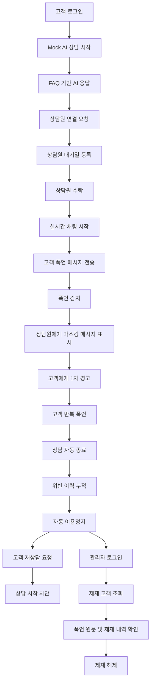

# 사용자 흐름도

> 출처: Notion 「사용자 흐름도」 (마지막 수정: 2026-11-09)

> **프로젝트:** AI 상담원 보호 및 자동 제재 플랫폼
>
> **목적:** 고객·상담원·관리자가 서비스를 이용하는 과정에서 화면 이동, 조건 분기, 예외 상황을 정의한다.
>
> **작성 기준:** 사용자 시나리오 및 기능 요구사항(REQ-001\~033)

## 1. 사용자 흐름도 개요

사용자 흐름도는 사용자가 서비스를 이용할 때 어떤 화면을 어떤 순서로 이동하는지 정리한 문서이다.

사용자 시나리오가 문장으로 작성한 흐름이라면, 사용자 흐름도는 그 흐름을 화면 이동 중심으로 시각화한 것이다.

본 프로젝트는 사용자 권한에 따라 세 가지 흐름으로 구분한다.

| 사용자 | 주요 기능 | 최종 목적 |
| --- | --- | --- |
| 고객 (CUSTOMER) | 회원가입, 로그인, Mock AI 상담, 상담원 연결, 실시간 채팅, 이용정지 안내 | 고객 문의 해결 |
| 상담원 (AGENT) | 대기 상담 조회, 상담 수락, 실시간 채팅, 폭언 경고 확인, 상담 종료 | 안전한 상담 업무 수행 |
| 관리자 (ADMIN) | 제재 현황 조회, 제재 해제, 폭언 원문 확인, 정책 관리, 상담 이력·통계 | 상담 운영 및 제재 관리 |

---

## 2. 작성 기준

| 항목 | 작성 내용 |
| --- | --- |
| 시작 지점 | 메인 페이지 또는 권한별 대시보드 |
| 화면 이동 | 로그인, 메뉴 선택, 상담 시작, 상담 수락 등 |
| 조건 분기 | 인증 여부, 권한, 상담 상태, 폭언 여부, 제재 상태 |
| 종료 지점 | 상담 종료, 이용정지 안내, 관리자 처리 완료 |
| 예외 처리 | 로그인 실패, AI 응답 실패, 상담원 부재, 연결 끊김, 접근 권한 없음 |
| 화면 구분 | 실제 페이지 이동과 동일 페이지 내 상태·모달 변경을 구분 |

---

## 3. 전체 사용자 흐름도

전체 흐름도는 사용자 권한에 따른 주요 화면 이동을 중심으로 작성한다. 폭언 처리와 자동 제재 등 복잡한 로직은 별도 흐름도로 분리한다.

> 🖼️ (노션 이미지: 전체 사용자 흐름도)

---

## 4. 회원가입 / 로그인 흐름

**대상:** 고객, 상담원, 관리자

**관련 요구사항:** REQ-001, REQ-002, REQ-003

> 🖼️ (노션 이미지: 회원가입 / 로그인 흐름도)

### 주요 처리 규칙

- 고객은 회원가입 후 로그인한다.
- 상담원·관리자 계정은 사전에 등록된 계정을 사용하는 것을 기본으로 한다.
- 로그인 성공 시 사용자 권한에 맞는 화면으로 이동한다.
- 접근 권한이 없는 페이지는 표시하지 않는다.
- 로그아웃 시 인증 정보를 제거하고 로그인 페이지로 이동한다.
- 이용정지된 고객도 로그인은 가능하지만 상담 시작은 제한한다.

---

## 5. 고객 Mock AI 상담 흐름

**대상:** 고객

**관련 요구사항:** REQ-004, REQ-005, REQ-006, REQ-008, REQ-022

> 🖼️ (노션 이미지: 고객 Mock AI 상담 흐름도)

### 주요 처리 규칙

- Mock AI는 사전에 정의된 FAQ 데이터를 기반으로 답변한다.
- AI 응답은 실제 LLM 호출 없이 순차 출력 방식으로 구현한다.
- FAQ에 적절한 답변이 없거나 응답 실패 시 대체 메시지를 제공한다.
- 고객은 상담원 연결을 직접 요청할 수 있다.
- 제재 상태인 고객은 새로운 상담을 시작할 수 없다.

---

## 6. 고객 상담원 연결 흐름

**대상:** 고객

**관련 요구사항:** REQ-007, REQ-009, REQ-010, REQ-011

> 🖼️ (노션 이미지: 고객 상담원 연결 흐름도)

### 주요 처리 규칙

- 상담원 연결 요청 시 상담 상태를 `QUEUED`로 변경한다.
- 상담원이 수락하면 `IN_PROGRESS`로 변경한다.
- 상담 대기 중에는 연결 상태를 표시한다.
- 상담원 연결 전 고객이 대기 화면을 벗어나는 경우에도 서버의 상담 상태를 기준으로 처리한다.
- 상담이 종료되면 메시지 전송을 차단한다.

---

## 7. 고객 실시간 채팅 흐름

**대상:** 고객

**관련 요구사항:** REQ-011, REQ-014\~017

> 🖼️ (노션 이미지: 고객 실시간 채팅 흐름도)

### 주요 처리 규칙

- 고객 메시지는 서버에서 폭언 여부를 판정한다.
- 폭언으로 판정된 메시지는 상담원에게 전달되기 전에 마스킹한다.
- 상담원에게 폭언 원문을 전달하지 않는다.
- 경고 횟수가 정책 기준에 도달하면 상담을 자동 종료한다.
- 상담 종료 이후에는 추가 메시지 전송이 불가능하다.

---

## 8. 폭언 감지 및 자동 경고 흐름

**대상:** 고객, 상담원

**관련 요구사항:** REQ-014, REQ-015, REQ-016

이 흐름은 별도 페이지 이동이 아닌 실시간 채팅 화면 내 상태 변경을 중심으로 작성한다.

> 🖼️ (노션 이미지: 폭언 감지 및 자동 경고 흐름도)

### 주요 처리 규칙

- 폭언 감지 결과는 `NORMAL`, `ABUSIVE`로 구분한다.
- 고객에게 경고 메시지를 표시한다.
- 상담원에게는 마스킹된 메시지만 표시한다.
- 폭언 원문은 관리자 권한으로만 조회할 수 있다.
- 중복 메시지로 인해 경고 횟수가 중복 증가하지 않도록 처리한다.

---

## 9. 상담 자동 종료 및 이용정지 흐름

**대상:** 고객

**관련 요구사항:** REQ-017, REQ-020, REQ-021, REQ-022, REQ-023

> 🖼️ (노션 이미지: 상담 자동 종료 및 이용정지 흐름도)

### 자동 제재 정책

| 상황 | 처리 |
| --- | --- |
| 상담 중 첫 번째 폭언 | 경고 1회 |
| 같은 상담 중 두 번째 폭언 | 상담 자동 종료 |
| 강제 종료 1회 | 위반 1회 누적 |
| 누적 위반 1회 | 7일 이용정지 |
| 누적 위반 2회 | 30일 이용정지 |
| 누적 위반 3회 이상 | 90일 이용정지 및 관리자 검토 |
| 제재 기간 만료 | 상담 시작 허용 |

해당 정책은 현재 프로젝트의 기본 정책안이며, 최종 정책정의서의 수치를 기준으로 구현한다.

---

## 10. 상담원 대기 상담 수락 흐름

**대상:** 상담원

**관련 요구사항:** REQ-009, REQ-010, REQ-012

> 🖼️ (노션 이미지: 상담원 대기 상담 수락 흐름도)

### 주요 처리 규칙

- 상담원은 `QUEUED` 상태의 상담을 조회한다.
- 하나의 상담은 한 명의 상담원만 수락할 수 있다.
- 중복 수락이 발생하면 먼저 성공한 요청만 인정한다.
- 수락에 실패한 상담원에게는 오류 메시지를 표시한다.
- 이전 Mock AI 상담 내역 조회는 추가 기능으로 구현할 수 있다.

---

## 11. 상담원 실시간 상담 및 종료 흐름

**대상:** 상담원

**관련 요구사항:** REQ-011, REQ-013, REQ-015, REQ-017, REQ-018

> 🖼️ (노션 이미지: 상담원 실시간 상담 및 종료 흐름도)

### 주요 처리 규칙

- 상담원은 일반 고객 메시지를 확인하고 답변할 수 있다.
- 폭언 메시지는 마스킹된 형태로 표시한다.
- 자동 종료 시 상담원과 고객 모두에게 종료 안내를 표시한다.
- 정상 종료 시 `CLOSED`, 폭언에 의한 강제 종료 시 `CLOSED`로 구분한다.
- 상담원 수동 경고 및 수동 종료는 추가 기능으로 구현할 수 있다.

---

## 12. 관리자 제재 관리 흐름

**대상:** 관리자

**관련 요구사항:** REQ-025, REQ-026

> 🖼️ (노션 이미지: 관리자 제재 관리 흐름도)

### 주요 처리 규칙

- 관리자만 제재 목록 및 제재 상세 정보를 조회할 수 있다.
- 폭언 원문은 관리자 권한을 확인한 후 표시한다.
- 제재 해제 시 확인 절차를 거친다.
- 제재 해제 결과는 고객의 상담 시작 가능 여부에 반영한다.
- 제재 해제 후에도 위반 이력은 보존한다.

---

## 13. 관리자 정책 관리 흐름

**대상:** 관리자

**관련 요구사항:** REQ-024

**우선순위:** Should (추가 기능)

> 🖼️ (노션 이미지: 관리자 정책 관리 흐름도)

### 주요 처리 규칙

- 관리자만 제재 정책을 수정할 수 있다.
- 경고 횟수와 제재 기간은 유효한 값만 입력할 수 있다.
- 정책 변경 사항은 이후 폭언 판정 및 제재 처리에 반영한다.
- 7일 개발 일정상 관리자 정책 수정 기능이 미완성인 경우 고정 정책으로 시연한다.

---

## 14. 상담 이력 및 요약 조회 흐름

**대상:** 상담원, 관리자

**관련 요구사항:** REQ-029, REQ-030, REQ-031

> 🖼️ (노션 이미지: 상담 이력 및 요약 조회 흐름도)

### 주요 처리 규칙

- 상담원과 관리자는 권한에 따라 상담 이력을 조회한다.
- 고객은 본인의 상담 이력만 조회할 수 있다.
- Mock 상담 요약은 규칙 기반 템플릿으로 생성한다.
- 상담 상세 화면에는 상담 상태, 메시지 내역, 종료 사유 등을 표시한다.
- 폭언 원문은 일반 상담 이력 화면에 표시하지 않는다.
- 고객 본인 상담 이력은 추가 기능으로 구현할 수 있다.

---

## 15. 관리자 통계 대시보드 흐름

**대상:** 관리자

**관련 요구사항:** REQ-032

> 🖼️ (노션 이미지: 관리자 통계 대시보드 흐름도)

### 주요 처리 규칙

- 대시보드는 저장된 상담·위반·제재 데이터를 기준으로 집계한다.
- 통계 데이터가 없는 경우 빈 상태 화면을 표시한다.
- 통계 수치는 Mock 데이터와 실제 저장된 상담 데이터의 기준을 일치시킨다.
- 같은 메시지나 위반 기록이 중복 집계되지 않도록 한다.

---

## 16. WebSocket 연결 끊김 및 재연결 흐름

**대상:** 고객, 상담원

**관련 요구사항:** NFR-007, NFR-008

> 🖼️ (노션 이미지: WebSocket 연결 끊김 및 재연결 흐름도)

### 주요 처리 규칙

- 연결이 끊어지면 사용자에게 상태를 안내한다.
- 재연결 후 서버의 상담 상태를 다시 확인한다.
- 진행 중인 상담이라면 저장된 메시지 이력을 불러온다.
- 이미 종료된 상담이라면 채팅 화면으로 복귀시키지 않는다.
- 재연결 과정에서 메시지가 중복 표시되거나 중복 저장되지 않도록 한다.

---

## 17. 화면 목록

사용자 흐름도에서 정의한 화면을 화면 설계서와 연결한다.

| 화면 ID | 화면명 | 사용자 | 주요 기능 |
| --- | --- | --- | --- |
| SCR-001 | 메인 페이지 | 전체 | 서비스 진입 |
| SCR-002 | 회원가입 페이지 | 고객 | 계정 생성 |
| SCR-003 | 로그인 페이지 | 전체 | 로그인 |
| SCR-004 | 고객 메인 페이지 | 고객 | 상담 시작 |
| SCR-005 | Mock AI 상담 화면 | 고객 | FAQ 기반 상담 |
| SCR-006 | 상담원 연결 대기 화면 | 고객 | 연결 상태 확인 |
| SCR-007 | 고객 실시간 채팅 화면 | 고객 | 상담원과 채팅 |
| SCR-008 | 상담 종료 결과 화면 | 고객 | 종료 결과 확인 |
| SCR-009 | 이용정지 안내 화면 | 고객 | 제재 기간·사유 확인 |
| SCR-010 | 상담원 콘솔 | 상담원 | 대기 상담 목록 |
| SCR-011 | 상담원 실시간 채팅 화면 | 상담원 | 상담 수락·응대 |
| SCR-012 | 관리자 대시보드 | 관리자 | 운영 현황 |
| SCR-013 | 제재 관리 화면 | 관리자 | 제재 목록 조회 |
| SCR-014 | 제재 상세 화면 | 관리자 | 위반 내역·제재 해제 |
| SCR-015 | 정책 관리 화면 | 관리자 | 경고·제재 기준 수정 |
| SCR-016 | 상담 이력 목록 | 상담원·관리자 | 종료 상담 조회 |
| SCR-017 | 상담 상세 화면 | 권한별 | 메시지·요약 확인 |
| SCR-018 | 통계 대시보드 | 관리자 | 상담·폭언 통계 |
| SCR-019 | 내 상담 이력 | 고객 | 본인 상담 기록 조회 |

※ 경고 알림, 상담 수락 실패, 연결 끊김, 원문 확인 등은 별도 페이지가 아닌 모달·알림·화면 상태로 구현할 수 있다.

---

## 18. 사용자 흐름도 작성 시 주의사항

- 전체 흐름도에는 주요 화면만 포함하고, 복잡한 기능은 별도 흐름도로 분리한다.
- 화면 이름은 화면 설계서와 동일하게 사용한다.
- 로그인 여부와 권한에 따른 분기를 명확히 표시한다.
- 상담 상태는 `AI_CHAT`, `QUEUED`, `IN_PROGRESS`, `CLOSED`, `CLOSED`로 통일한다.
- 폭언 감지·마스킹·자동 종료는 서버 처리 흐름과 화면 상태 변경을 구분한다.
- 폭언 원문은 상담원 화면에 노출하지 않는다.
- 이용정지된 고객의 신규 상담 시작을 차단한다.
- 관리자만 폭언 원문을 확인할 수 있다.
- API 실패, WebSocket 끊김, 상담 중복 수락 등의 예외 흐름을 포함한다.
- Must 기능을 우선 구현하고 Should·Could 기능은 일정에 따라 조정한다.
- 흐름도에서 정의한 화면은 화면 설계서와 연결한다.

---

## 19. 핵심 시연 흐름

최종 발표에서 사용할 대표 사용자 흐름이다.

**최종 목표:** 고객 문의부터 Mock AI 응대, 상담원 연결, 폭언 감지, 마스킹, 자동 종료, 이용정지, 관리자 제재 관리까지 전체 서비스 흐름을 일관되게 구현한다.
