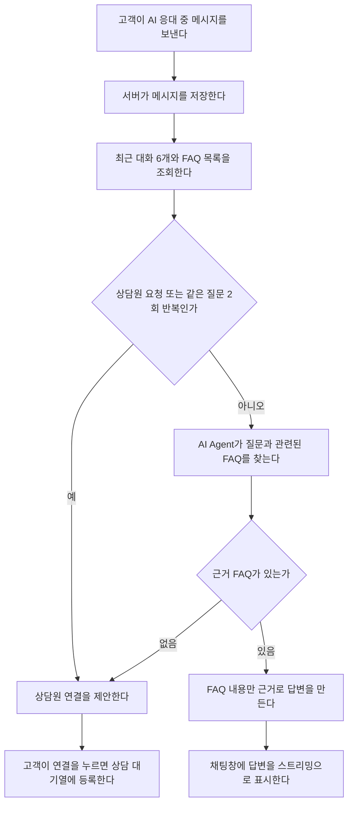
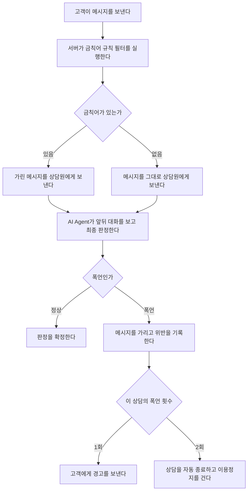
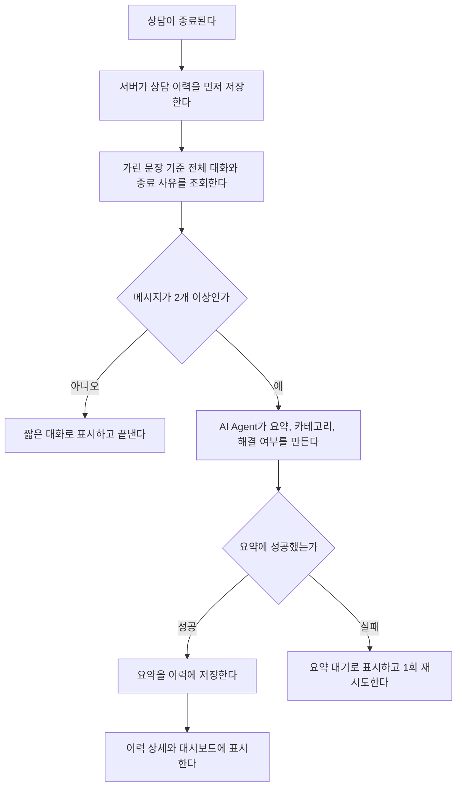

# AI Agent 기능 기획서

> 출처: Notion 「AI Agent 기능 기획서」 (마지막 수정: 2026-11-09)

이 문서는 프로젝트의 2차 디벨롭 단계에서 추가할 AI Agent 기능을 정의하기 위한 문서이다.

AI Agent가 어떤 상황에서 실행되고, “어떤 데이터를 보고, 어떤 결과를 만드는지”를 반드시 작성한다.

---

## AI Agent 기능 목록

| Agent명 | 사용 대상 | 우선 순위 | 한 줄 설명 |
| --- | --- | --- | --- |
| [1차 상담 응대 Agent](#1차-상담-응대-agent) | 고객 |  | AI 응대 중인 고객 질문에 FAQ를 근거로 답하고, FAQ로 답할 수 없는 문의는 상담원에게 연결해요. |
| [폭언 분류 Agent](#폭언-분류-agent) | 상담원(보호 대상), 고객(경고 대상) |  | 고객 메시지를 앞뒤 대화와 함께 보고 폭언인지 판정해요. 폭언이면 상담원 화면에서 가리고, 위반으로 기록해 경고·자동 종료의 근거로 써요. |
| [상담 요약 Agent](#상담-요약-agent) | 상담원, 관리자 |  | 상담이 끝나면 대화를 3줄로 요약하고, 문의 카테고리와 해결 여부를 정리해 상담 이력과 대시보드에 남겨요. |

---

## 1차 상담 응대 Agent

| 항목 | 내용 |
| --- | --- |
| Agent명 | 1차 상담 응대 Agent |
| 사용 목적 | 반복 문의는 AI가 먼저 해결해 상담원 업무량을 줄이고, AI가 답할 수 없는 문의만 상담원에게 넘긴다. |
| 사용 대상 | 고객 |
| 실행 시점 | 상담 상태가 'AI 응대'일 때 고객이 메시지를 보낼 때마다 |
| 입력 데이터 | 고객 메시지, 같은 상담의 최근 대화 6개, FAQ 목록(질문·답변·카테고리) |
| 처리 내용 | 먼저 상담원 연결 조건(고객의 상담원 요청, 같은 질문 2회 반복)을 확인한다. 해당하지 않으면 질문과 관련된 FAQ를 찾고, 찾은 FAQ 내용만 근거로 답변을 만든다. 근거 FAQ가 없으면 지어내지 않고 상담원 연결을 제안한다. |
| 출력 결과 | 답변 문장(스트리밍), 근거 FAQ ID, 상담원 연결 필요 여부와 사유 |
| 결과 노출 화면 | 고객 채팅창 (답변 말풍선, 상담원 연결 버튼) |
| 예외 상황 | AI가 10초 안에 답하지 않거나 실패하면 FAQ 키워드 매칭 답변을 보여준다. 매칭되는 FAQ도 없으면 "정확한 답변을 위해 상담원을 연결해 드릴까요?"라고 안내하고 연결 버튼을 띄운다. |

**왜 이렇게 설계했나**

- **근거 FAQ가 없으면 답하지 않는다.** 상담 서비스에서 AI가 틀린 정책을 안내하면 그 뒷수습은 결국 상담원이 한다. 모르는 질문을 사람에게 넘기는 것이 상담원 보호라는 서비스 목적에 맞다.
- **상담원 연결 조건을 답변 생성보다 먼저 확인한다.** 상담원을 원하는 고객에게 AI 답변을 한 번 더 보여주면 고객 불만이 쌓이고, 그 불만이 폭언으로 이어질 수 있다.
- **최근 대화는 6개만 보낸다.** "같은 질문 반복"을 판단하는 데는 직전 몇 턴이면 충분하고, 전체 대화를 보내면 응답이 느려져 10초 제한에 걸릴 가능성이 커진다.

---

## 폭언 분류 Agent

| 항목 | 내용 |
| --- | --- |
| Agent명 | 폭언 분류 Agent |
| 사용 목적 | 상담원이 폭언 원문을 보지 않게 하고, 폭언을 위반으로 기록해 경고·종료·이용정지의 근거로 쓴다. |
| 사용 대상 | 상담원(보호 대상), 고객(경고 대상) |
| 실행 시점 | 고객이 메시지를 보낼 때마다 |
| 입력 데이터 | 고객 메시지 원문, 금칙어 규칙 필터 결과, 같은 상담의 직전 메시지 2개 |
| 처리 내용 | 1단계로 금칙어 규칙 필터가 즉시 판정해 가린 메시지를 상담원에게 보낸다. 2단계로 AI Agent가 앞뒤 대화를 보고 정상/폭언을 최종 판정한다. 폭언으로 확정되면 위반을 기록하고, 이 상담의 폭언 횟수에 따라 경고 또는 자동 종료를 실행한다. |
| 출력 결과 | 판정(정상/폭언), 가린 문장, 판정 사유, 위반 이벤트(고객 ID, 상담 ID, 메시지 ID) |
| 결과 노출 화면 | 상담원 상담 화면(가린 메시지, 폭언 배지), 고객 채팅창(경고·종료 안내), 관리자 제재 고객 목록 |
| 예외 상황 | AI가 3초 안에 답하지 않거나 실패하면 금칙어 규칙 필터 결과를 최종 판정으로 쓴다. |

**왜 이렇게 설계했나**

- **규칙 필터와 AI의 역할을 나눴다.** 규칙 필터는 빠르지만 우회 표현("ㅅㅂ", 띄어쓰기 변형)과 비꼬는 말을 못 잡는다. AI는 문맥을 보지만 1~3초가 걸린다. 그래서 상담원 보호(가리기)는 즉시 하는 규칙 필터가 맡고, 제재로 이어지는 최종 판정은 AI가 맡는다.
- **위반 기록은 AI 판정 뒤에만 한다.** 금칙어 오탐(예: "시발점")으로 고객에게 경고가 가면 서비스 신뢰가 깨진다. 경고가 1~3초 늦어지는 것보다 잘못된 경고가 더 큰 문제다.
- **채팅 전송을 AI 판정까지 기다리게 하지 않는다.** 모든 메시지가 AI를 기다리면 정상 고객의 채팅까지 느려진다. 폭언 고객은 일부지만, 지연은 모든 고객이 겪는다.

---

## 상담 요약 Agent

| 항목 | 내용 |
| --- | --- |
| Agent명 | 상담 요약 Agent |
| 사용 목적 | 상담원이 상담 기록을 직접 쓰지 않게 하고, 관리자가 상담 내용과 문의 유형을 빠르게 파악하게 한다. |
| 사용 대상 | 상담원, 관리자 |
| 실행 시점 | 상담이 끝났을 때(정상 종료, 폭언 자동 종료 모두) 백그라운드에서 1회 |
| 입력 데이터 | 상담 전체 메시지(가린 문장 기준), 종료 사유, 폭언 횟수, FAQ 카테고리 목록 |
| 처리 내용 | 대화 전체를 읽고 문의 내용, 처리 결과, 남은 문제를 3줄 이내로 요약한다. 문의 카테고리는 FAQ 카테고리 목록 중 하나로 고른다. |
| 출력 결과 | 요약(3줄 이내), 문의 카테고리, 해결 여부 |
| 결과 노출 화면 | 상담 이력 상세, 대시보드(카테고리별 상담 수, AI 단독 해결 비율) |
| 예외 상황 | AI가 실패하면 요약 없이 이력을 먼저 저장하고 '요약 대기'로 표시한 뒤 1회 재시도한다. 메시지가 2개 미만이면 "대화가 짧아 요약하지 않았습니다."로 저장한다. |

**왜 이렇게 설계했나**

- **원문이 아닌 가린 문장을 요약한다.** 원문을 넣으면 요약에 폭언이 그대로 옮겨질 수 있고, 상담원이 이력을 볼 때 다시 노출된다.
- **카테고리를 정해진 목록에서만 고른다.** AI가 카테고리를 자유롭게 쓰면 "배송 문의", "배송 지연", "택배"처럼 같은 문의가 다르게 기록되어 대시보드에서 집계할 수 없다.
- **이력 저장과 요약을 분리한다.** 요약이 실패해도 상담 기록 자체는 남아야 한다. 요약은 나중에 다시 만들 수 있지만 대화 기록은 다시 만들 수 없다.

